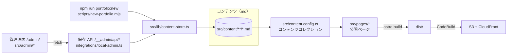
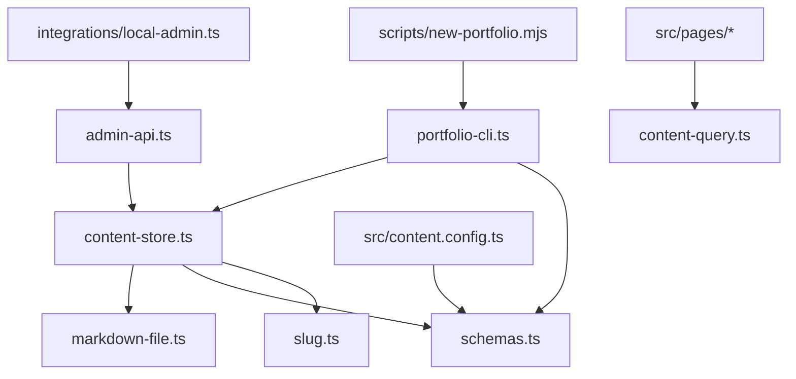

# プロジェクト構成

`portfolio-site/` のディレクトリ構成と、各ファイルの役割・つながりをまとめる。使い方（起動・コンテンツの追加）は [../README.md](../README.md)、AWS の構成と構築手順は [../infra/README.md](../infra/README.md) を参照。

## 全体像



- 自己紹介・ポートフォリオ・記事はすべて md ファイルで、frontmatter がデータ（タイトル・タグなど）、本文が内容になる。
- 公開ページはビルド時に md を読み込んで静的 HTML を作る。閲覧時にサーバー処理はない。
- md への書き込みは2経路だけ。ポートフォリオはコマンド、自己紹介と記事は開発サーバー上の管理画面から。どちらも `content-store.ts` を通り、同じスキーマで検証してから書く。
- 管理画面と保存 API は `astro dev` のときだけ登録され、`dist/` には含まれない。

## ディレクトリ構成

```
portfolio-site/
├── README.md                     # 使い方（起動・コンテンツの更新）
├── docs/
│   ├── project-structure.md      # このファイル
│   └── content-files.md          # コンテンツファイル（自己紹介・ポートフォリオ・記事）の書式と追加方法
├── package.json                  # 依存と npm scripts
├── astro.config.mjs              # Astro の設定（静的出力、末尾スラッシュ、Tailwind、管理画面インテグレーション）
├── tsconfig.json                 # TypeScript の設定（astro/tsconfigs/strict を継承）
├── eslint.config.mjs             # ESLint（JS・TS・Astro）
├── vitest.config.ts              # 単体テストの設定（build-output.test.ts を除く）
├── vitest.build.config.ts        # ビルド成果物のテストの設定（npm run test:build）
├── buildspec.test.yml            # CodeBuild: テスト用（プルリクエスト）
├── buildspec.yml                 # CodeBuild: デプロイ用（main への push）
├── infra/
│   ├── README.md                 # AWS の構成・構築手順
│   └── template.yaml             # CloudFormation テンプレート
├── integrations/
│   └── local-admin.ts            # 管理画面のルートと保存 API を開発サーバーにだけ追加する
├── scripts/
│   ├── new-portfolio.mjs         # ポートフォリオ追加コマンドの入口
│   └── vitest.mjs                # Windows のドライブ文字問題を避けて vitest を起動する
├── src/
│   ├── content.config.ts         # コンテンツコレクションの定義
│   ├── content/                  # コンテンツ（md）
│   ├── lib/                      # ページ・管理画面・コマンドで共有する処理
│   ├── pages/                    # 公開ページ（ファイルベースのルーティング）
│   ├── layouts/                  # 公開ページの共通レイアウト
│   ├── components/               # 公開ページの部品
│   ├── admin/                    # 管理画面（src/pages の外に置き、本番ビルドに含めない）
│   └── styles/global.css         # Tailwind CSS と typography プラグインの読み込み
└── tests/                        # vitest のテスト
```

生成物（git 管理外）: `node_modules/`、`dist/`（ビルド結果）、`.astro/`（Astro が生成する型定義）。

## src/content（コンテンツ）

| パス | コレクション | 内容 |
|---|---|---|
| `profile/profile.md` | `profile` | 自己紹介・経歴（1件だけ） |
| `portfolios/<スラッグ>.md` | `portfolios` | ポートフォリオ1件 |
| `articles/<スラッグ>.md` | `articles` | 記事1件 |

- ファイル名（拡張子を除く）がスラッグになり、URL に使われる（例: `articles/hello-world.md` → `/articles/hello-world/`）。
- frontmatter の項目は `src/lib/schemas.ts` で定義している。項目・書式・追加方法は [content-files.md](content-files.md) を参照。
- 同梱の md はすべて動作確認用のサンプル。`articles/draft-sample.md` は `draft: true` のため公開されない。

## src/pages・layouts・components（公開ページ）

| ファイル | URL | 内容 |
|---|---|---|
| `pages/index.astro` | `/` | 氏名・肩書き・一言紹介、ポートフォリオのタイル一覧、最新記事3件 |
| `pages/about.astro` | `/about/` | 自己紹介・経歴（`profile.md` の本文） |
| `pages/portfolios/index.astro` | `/portfolios/` | ポートフォリオの一覧（全件をタイルで表示。並び順はトップと同じ） |
| `pages/portfolios/[slug].astro` | `/portfolios/<スラッグ>/` | ポートフォリオの詳細（タイトル・タグ・URL・本文） |
| `pages/articles/index.astro` | `/articles/` | 記事一覧（新しい順、下書きを除く） |
| `pages/articles/[slug].astro` | `/articles/<スラッグ>/` | 記事の詳細（下書きはページを生成しない） |
| `pages/404.astro` | `/404.html` | 見つからないページ（CloudFront の 403/404 でも表示） |

| 部品 | 内容 |
|---|---|
| `layouts/BaseLayout.astro` | `<html>`・ヘッダー・フッターと、`global.css` の読み込み |
| `components/SiteHeader.astro` | サイト名とナビゲーション（ホーム・自己紹介・ポートフォリオ・記事） |
| `components/PortfolioTile.astro` | ポートフォリオのタイル。タイトルのリンクをタイル全体に広げ（stretched link）、URL ボタンは入れ子にせず手前に重ねる |
| `components/TagList.astro` | タグの一覧（タグがなければ何も出さない） |

## src/lib（共有の処理）

ページ・管理画面・コマンドから使う処理。Astro の実行環境に依存しない純粋な TypeScript にして、vitest で直接テストする。

| ファイル | 役割 | 主な利用元 |
|---|---|---|
| `schemas.ts` | frontmatter の zod スキーマ（profile・portfolio・article）。ビルド時と保存時で同じものを使う | `content.config.ts`、`content-store.ts`、`portfolio-cli.ts` |
| `markdown-file.ts` | md の全文を frontmatter と本文に分ける／組み立てる | `content-store.ts` |
| `slug.ts` | スラッグの検証（英小文字・数字・ハイフン、64文字まで）。パスを組み立てる前に必ず通す | `content-store.ts`、`portfolio-cli.ts` |
| `errors.ts` | `ContentValidationError`（入力が不正）、`ContentConflictError`（同名ファイルがある） | 各モジュール |
| `content-store.ts` | md ファイルの書き込み。自己紹介の置き換え（一時ファイル + rename）、記事・ポートフォリオの新規作成（既存は上書きしない） | `admin-api.ts`、`portfolio-cli.ts` |
| `content-query.ts` | 一覧の並び順、下書きの除外、日付の表示形式 | 公開ページ |
| `admin-api.ts` | 保存 API の処理本体。Origin・Content-Type の検査、ルーティング、エラーと HTTP ステータスの対応 | `integrations/local-admin.ts` |
| `portfolio-cli.ts` | ポートフォリオ追加コマンドの引数解析と実行 | `scripts/new-portfolio.mjs` |

依存の向き（矢印の先を使う）:



## 管理画面（integrations/local-admin.ts・src/admin）

| ファイル | 内容 |
|---|---|
| `integrations/local-admin.ts` | Astro インテグレーション。`astro dev` のときだけ、`/admin/` 以下のルートを登録し、保存 API（`/__admin/api/*`）を開発サーバーのミドルウェアとして追加する。本文は 1 MB まで |
| `src/admin/AdminLayout.astro` | 管理画面の共通レイアウト（`noindex`） |
| `src/admin/index.astro` | `/admin/`。メニュー |
| `src/admin/profile.astro` | `/admin/profile/`。`profile.md` の全文を編集して保存（`PUT /__admin/api/profile`） |
| `src/admin/article-new.astro` | `/admin/articles/new/`。フォーム入力または md ファイルのアップロードで記事を作成（`POST /__admin/api/articles`） |
| `src/admin/admin-client.ts` | ブラウザ側の共通処理（API への送信と結果表示、フォーム入力から md を組み立てる） |

ポートフォリオを追加する API は意図的に用意していない（追加はコマンドだけ）。

## CI・インフラ

| ファイル | 内容 |
|---|---|
| `buildspec.test.yml` | プルリクエストで実行。`npm ci` → `npm test` → `npm run lint` → `npm run test:build` |
| `buildspec.yml` | `main` への push で実行。上と同じ検証のあと、成功したら S3 に同期して CloudFront のキャッシュを無効化 |
| `infra/template.yaml` | S3・CloudFront・ACM・Route 53・CodeBuild（テスト用とデプロイ用）を作る CloudFormation テンプレート |

詳細は [../infra/README.md](../infra/README.md)。

## tests（テスト）

`npm test` で実行する単体テストと、`npm run test:build` で実行するビルド成果物のテストがある。

| テスト | 対象 |
|---|---|
| `slug.test.ts`・`schemas.test.ts`・`markdown-file.test.ts` | スラッグ検証・スキーマ・md の解析 |
| `content-store.test.ts` | md の書き込み（上書き禁止、検証失敗時にファイルを変えない、ディレクトリ外に書かない） |
| `content-query.test.ts` | 並び順・下書き除外・日付表示 |
| `portfolio-cli.test.ts` | ポートフォリオ追加コマンド |
| `admin-api.test.ts`・`admin-client.test.ts`・`local-admin.test.ts` | 保存 API、管理画面の md 組み立て、dev 限定のルート登録と本文サイズ上限 |
| `infra-template.test.ts`（`helpers/cfn-yaml.ts` で読み込み）・`buildspec.test.ts` | CloudFormation の設定値と buildspec の手順 |
| `build-output.test.ts` | `dist/` の HTML（タイル・詳細・下書き除外・管理画面が含まれないこと）。`npm run test:build` のみ |
