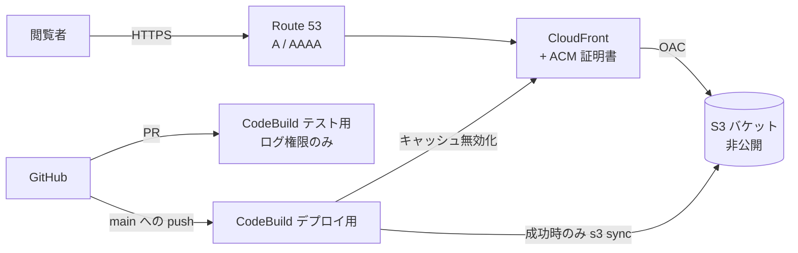

# infra（AWS 構成）

ポートフォリオサイトを AWS 上で配信し、CodeBuild で CI/CD を行うための CloudFormation テンプレートです。テンプレート1つ（[template.yaml](template.yaml)）で、配信基盤と CI をまとめて作成します。

## 構成



| ファイル | 内容 |
|---|---|
| [template.yaml](template.yaml) | CloudFormation テンプレート（このディレクトリ） |
| [../buildspec.test.yml](../buildspec.test.yml) | テスト用のビルド手順。プルリクエストで実行（`CodeBuildTestProject` から参照） |
| [../buildspec.yml](../buildspec.yml) | デプロイ用のビルド手順。`DeployBranch`（未指定なら任意のブランチ）への push で実行（`CodeBuildProject` から参照） |
| [../tests/infra-template.test.ts](../tests/infra-template.test.ts) | テンプレートの設定値を検証するテスト（`npm test` で実行） |

## 作成されるリソース

| 論理 ID | 種類 | 内容 |
|---|---|---|
| `SiteBucket` | S3 バケット | サイトのファイル置き場。パブリックアクセスをすべてブロック、SSE-S3 暗号化、バージョニング有効（旧バージョンは30日で削除）。スタックを削除しても残る（`DeletionPolicy: Retain`） |
| `SiteBucketPolicy` | バケットポリシー | このディストリビューションからの `s3:GetObject` だけを許可。HTTPS 以外のアクセスは拒否 |
| `OriginAccessControl` | CloudFront OAC | CloudFront が署名付きで S3 を読むための設定 |
| `Certificate` | ACM 証明書 | `DomainName` の証明書。DNS 検証で、検証用レコードはホストゾーンに自動作成される |
| `DirectoryIndexFunction` | CloudFront Function | `/about/` や `/about` へのリクエストを `/about/index.html` に置き換える（Astro の出力形式に合わせる） |
| `Distribution` | CloudFront | HTTPS へリダイレクト、TLS 1.2 以上、HTTP/2・HTTP/3、IPv6。キャッシュはマネージドの CachingOptimized、レスポンスヘッダーは SecurityHeadersPolicy。403/404 は `/404.html` を 404 で返す |
| `AliasRecordA` / `AliasRecordAAAA` | Route 53 | `DomainName` から CloudFront へのエイリアス |
| `BuildLogGroup` / `TestLogGroup` | CloudWatch Logs | CodeBuild のログ（デプロイ用・テスト用で分ける。30日保存） |
| `CodeBuildTestRole` | IAM ロール | テスト用。`TestLogGroup` への書き込みだけを許可（S3・CloudFront には触れない）。このアカウントの `<スタック名>-test` からだけ引き受けられる |
| `CodeBuildTestProject` | CodeBuild | `<スタック名>-test`。`GitHubActorAccountId` のアカウントが出した、`DeployBranch`（未指定なら任意のブランチ）を向き先とするプルリクエストだけで、テスト・lint・ビルドを実行する（同時実行は1件） |
| `CodeBuildRole` | IAM ロール | デプロイ用。`BuildLogGroup` への書き込み、`SiteBucket` の一覧・読み書き・削除、このディストリビューションの無効化だけを許可。このアカウントの `<スタック名>-deploy` からだけ引き受けられる |
| `CodeBuildProject` | CodeBuild | `<スタック名>-deploy`。`DeployBranch`（未指定なら任意のブランチ）への push でビルドし、成功したらデプロイする（同時実行は1件） |
| `WebAcl` | AWS WAF | `EnableWaf=true` のときだけ作る。IP ごとに 5 分間 1000 リクエストを超えたら遮断する |
| `CostBudget` | AWS Budgets | 月額料金が予算の 80% を超えた（実績）・100% を超えそう（予測）なときに `BudgetAlertEmail` へメールする |

## セットアップ

前提の準備（AWS CLI・Route 53 ホストゾーン・CodeBuild への GitHub 認証情報の登録）から、スタックの作成・出力の確認・初回デプロイまでの手順は [../docs/infra-setup.md](../docs/infra-setup.md) にまとめています。

## パラメーター

値は **パラメーターファイル `infra/parameters.json`** に書き、`aws cloudformation deploy` の `--parameter-overrides file://infra/parameters.json` で読み込む。メールアドレスやホストゾーン ID を含むため git の管理外（`.gitignore` 済み）で、[parameters.example.json](parameters.example.json) をコピーして作る。形式は `{ "Parameters": { "名前": "値" } }`（CodePipeline のテンプレート設定ファイルと同じ）。値はすべて文字列で書く。

> **Windows の場合**: AWS CLI は既定で OS の文字コード（日本語環境では cp932）でファイルを読むため、日本語を含む `template.yaml` で `'cp932' codec can't decode` のエラーになる。`aws cloudformation` のコマンドを実行する前に、環境変数 `AWS_CLI_FILE_ENCODING=UTF-8` を設定する（PowerShell: `$env:AWS_CLI_FILE_ENCODING = "UTF-8"`、Git Bash: `export AWS_CLI_FILE_ENCODING=UTF-8`）。

```bash
cp infra/parameters.example.json infra/parameters.json  # 値を書き換える
```

| 名前 | 必須 | 既定値 | 内容 |
|---|---|---|---|
| `DomainName` | ○ | — | サイトのドメイン名（例 `portfolio.example.com`）。`HostedZoneId` のゾーン内の名前にする |
| `HostedZoneId` | ○ | — | `DomainName` を管理している Route 53 ホストゾーンの ID |
| `GitHubRepoUrl` | ○ | — | GitHub リポジトリの HTTPS URL（例 `https://github.com/<owner>/<repo>.git`） |
| `DeployBranch` | | `""`（空） | push されたときに本番へデプロイするブランチ。空なら任意のブランチへの push でデプロイする（作業ブランチの push もそのまま本番に出る）。プルリクエストのテスト（`<スタック名>-test`）も、このブランチを向き先とする PR だけで実行する（Webhook の `BASE_REF`）。空なら任意のブランチ向けの PR でテストする |
| `GitHubActorAccountId` | ○ | — | プルリクエストのビルドを許可する GitHub アカウントの数値 ID（`gh api users/<ユーザー名> -q .id` で確認）。公開リポジトリのため、ほかのアカウントの PR ではビルドしない |
| `BudgetAlertEmail` | ○ | — | 料金アラートの送り先メールアドレス |
| `MonthlyBudgetUsd` | | `10` | 月額料金の予算（USD） |
| `EnableWaf` | | `false` | `true` で CloudFront に WAF（レート制限）を付ける。Web ACL とルールの月額固定費（数 USD）がかかる。`EnableCloudFront=false` なら作らない |
| `EnableCloudFront` | | `true` | `false` なら CloudFront・ACM 証明書・Route 53 レコード・ディレクトリ補完の Function・WAF を作らず、S3 へのアップロードだけを行う（ブラウザでは確認できない。キャッシュ無効化もしない）。このときだけ `DomainName`・`HostedZoneId` を空にできる |
| `SiteBucketName` | | `""`（空） | サイトのファイルを置くバケットの名前。空なら自動で付ける。作成済みのスタックで変えるとバケットが作り直される（旧バケットは残る） |
| `DeployPath` | | `""`（空） | バケット内のアップロード先のパス（例 `preview`）。CloudFront はこのパスをドメイン直下として配信する（`OriginPath`）。先頭・末尾に `/` を付けない。空ならバケット直下。デプロイ用ロールの S3 権限もこのパス以下に限る |
| `EnablePrTests` | | `true` | `false` ならプルリクエストのテスト用 CodeBuild（`<スタック名>-test`）とそのロール・ロググループを作らない（dev スタック用） |

## セキュリティ上の前提（テンプレートの外で設定するもの）

- **GitHub の認証情報は、このリポジトリだけに絞る**: CodeBuild に登録した認証情報は、そのアカウント・リージョンのすべての CodeBuild プロジェクトで共有される。AWS CodeConnections（GitHub App）を使うか、個人用アクセストークンならこのリポジトリだけを対象にした fine-grained トークンにする（classic トークンの `repo` は全リポジトリへの書き込み権限になる）。
- **デプロイするブランチにブランチ保護を付ける**: `DeployBranch` への push はそのまま本番に出る（`DeployBranch` が空なら、どのブランチへの push も本番に出るため、本番運用では `main` などを指定する）。GitHub の Settings → Branches で、PR 必須・テスト用 CodeBuild の成功必須・force push 禁止にする。
- **アカウントの監視を有効にする**: CloudTrail（管理イベント）と GuardDuty を有効にしておく（このテンプレートでは作らない）。料金は `CostBudget` のメールで気づけるようにしている。
- **ビルドで依存のインストールスクリプトを実行しない**: buildspec と `npm run build:apps` は `npm ci --ignore-scripts` で依存を入れる。インストール時のスクリプトが必要な依存を追加するときは、デプロイ用の権限で動くことを踏まえて buildspec に明示的に追加する。

## ブランチの役割

| ブランチ | 役割 | 自動で動くもの |
|---|---|---|
| `main` | 本番のブランチ。CI/CD・本番への自動デプロイ | PR でテスト（`<本番スタック名>-test`）。push でテスト後に本番へデプロイ（本番スタックの `DeployBranch=main`） |
| `dev-release` | dev 環境への自動デプロイ用 | push でテスト後に dev 環境へデプロイ（dev スタックの `DeployBranch=dev-release`） |
| `dev-main` | 開発用のブランチ | なし（`dev-main` 向けの PR ではテストされず、push してもデプロイされない。`portfolio-site/` 配下を変更していれば、`main` への PR でテストされる） |

どれも `portfolio-site/` 配下を変更したときだけ動きます（詳細は次の「CI / デプロイ」）。

PR のテスト（`<本番スタック名>-test`）は、本番スタックの `DeployBranch`（`main`）を向き先とする PR だけで動きます。GitHub のブランチ保護で `main` 以外のブランチ（`dev-main` など）にこのテストの成功を必須にしていると、チェックが来ずにマージできなくなるため、必須設定は `main` だけにします（`portfolio-site/` 配下を変更しない PR でもテストは動かないため、必須にするとそうした PR もマージできなくなる点に注意します）。
なお、作成済みの PR の向き先を後から `main` に変えただけでは、テストが始まらないことがあります（向き先の変更は「作成・更新・再オープン」のイベントに当たらないため）。そのときは PR にコミットを追加して push するか、PR を閉じて再オープンします。

## CI / デプロイ

テスト用とデプロイ用で、CodeBuild のプロジェクトと buildspec を分けています。プルリクエストのビルド（フォークからの PR を含む）は、デプロイ先への権限を持たないプロジェクトで実行されます。

Webhook が反応するのは、`portfolio-site/` 配下のファイルを変更した次のイベントだけです。

| イベント | プロジェクト | buildspec | 動作 |
|---|---|---|---|
| `DeployBranch`（未指定なら任意のブランチ）を向き先とするプルリクエストの作成・更新・再オープン | `<スタック名>-test` | [../buildspec.test.yml](../buildspec.test.yml) | テスト・lint・ビルドのみ。結果は GitHub の PR に表示される |
| `DeployBranch`（未指定なら任意のブランチ）への push | `<スタック名>-deploy` | [../buildspec.yml](../buildspec.yml) | テスト・lint・ビルド、成功したらデプロイ |

どちらの buildspec も、次の手順は共通です（同じであることをテストで確認しています）。

1. `install`: Node.js 22 で `npm ci`
2. `build`: `npm test` → `npm run lint` → `npm run test:build`（ビルドと、成果物に管理画面が含まれないことなどの検証）

デプロイ用の [../buildspec.yml](../buildspec.yml) だけが、続けて `post_build` を実行します。次の**すべて**を満たすときだけ、`dist/` を S3 の `DeployPath` 以下（空ならバケット直下）に同期（`--delete`）し、CloudFront のキャッシュを無効化します（`EnableCloudFront=false` のスタックでは無効化を省略します）。

- ビルドが成功している（`CODEBUILD_BUILD_SUCCEEDING = 1`）
- Webhook のイベントが `PUSH`
- push 先が `refs/heads/<DeployBranch>`（`DeployBranch` が空なら任意のブランチ `refs/heads/*`。タグは除く）

そのため、デプロイ用プロジェクトを CodeBuild のコンソールから手動で開始しても、Webhook のイベントがないのでデプロイされません。手動でテストだけを実行したいときは、テスト用プロジェクトでビルドを開始し、ソースのバージョンにブランチ名やコミットを指定します。

デプロイ用プロジェクトに渡す環境変数（テンプレートで設定。テスト用プロジェクトには渡さない）:

| 変数 | 値 |
|---|---|
| `SITE_BUCKET` | `SiteBucket` のバケット名 |
| `DISTRIBUTION_ID` | `Distribution` の ID（`EnableCloudFront=false` なら空） |
| `DEPLOY_PATH` | パラメーター `DeployPath`（空ならバケット直下） |
| `DEPLOY_BRANCH` | パラメーター `DeployBranch`（空なら任意のブランチ） |

## dev 環境

本番に出す前の確認用の dev 環境は、**同じ [template.yaml](template.yaml) から別スタックとして作る**（buildspec も本番と同じ [../buildspec.yml](../buildspec.yml)）。違いはパラメーターだけで、[parameters.dev.example.json](parameters.dev.example.json) を `infra/parameters.dev.json`（`.gitignore` 済み）にコピーして使う。

| パラメーター | 本番（例） | dev（例） |
|---|---|---|
| `DomainName` | `portfolio.example.com` | `dev.portfolio.example.com`（同じホストゾーンのサブドメインなら `HostedZoneId` も同じ） |
| `SiteBucketName` | `""`（自動で命名） | `portfolio-site-dev-<任意>` など、dev 用のバケット名 |
| `DeployBranch` | `main` | `dev-release` |
| `DeployPath` | `""`（バケット直下） | `""` または任意のパス |
| `EnableCloudFront` | `true` | `true`（ブラウザで確認するため） |
| `EnablePrTests` | `true` | `false`（PR のテストは本番スタックの `-test` で行い、二重に走らせない） |

```bash
cp infra/parameters.dev.example.json infra/parameters.dev.json  # 値を書き換える
aws cloudformation deploy --region us-east-1 --stack-name portfolio-site-dev \
  --template-file infra/template.yaml \
  --parameter-overrides file://infra/parameters.dev.json \
  --capabilities CAPABILITY_IAM
```

- スタック名は本番と別にし、`<本番のスタック名>-test` も避ける（CodeBuild のプロジェクト名・ロググループ名が重ならないようにするため。例 `portfolio-site-dev`）。
- dev のロールは dev スタックのバケット・ディストリビューションにしか権限がなく、本番には触れない。
- `CostBudget` はアカウント全体の料金を対象にするため、dev スタックの予算通知は本番と同じ金額（アカウント全体）で届く。重複が不要なら dev の `BudgetAlertEmail`・`MonthlyBudgetUsd` は本番と同じにしておく。
- `SiteBucketName` を指定したバケットはスタックを削除しても残る（`DeletionPolicy: Retain`）。同じ名前で作り直すときは、先に残ったバケットを空にして削除する（残っていると作成に失敗する）。
- 作成済みのスタックで `DeployPath` を変えると、CloudFront はすぐに新しいパスを配信するが、中身は次のデプロイ（push）まで空のため 404 になる。古いパスのファイルは残り、デプロイ用ロールからは消せなくなる。本番で変えるときは、先に新しいパスへ手動で同期しておく。

> **注意**: 本番スタックの `DeployBranch` が空のままだと、`dev-release` への push も本番の「任意のブランチへの push」に当たり、**本番にもデプロイされる**。dev 環境を使うときは、本番スタックの `DeployBranch` に `main` などを指定しておく。

## スタックの削除

```bash
aws cloudformation delete-stack --region us-east-1 --stack-name portfolio-site
```

S3 バケットは誤削除を防ぐため、スタックを消しても残ります（`DeletionPolicy: Retain`）。不要なら、バージョニングが有効なので**旧バージョンも含めて**空にしてから削除してください（コンソールの「空にする」が簡単です）。

## テンプレートを変更するとき

- `npm test` に含まれる [../tests/infra-template.test.ts](../tests/infra-template.test.ts) が、要件に関わる設定（非公開バケット、OAC、HTTPS 限定、us-east-1 の制約、Webhook の条件、IAM にワイルドカードの Action がないこと など）を検証します。設定を変えたらテストも合わせて更新してください。
- 反映前に `aws cloudformation deploy` に `--no-execute-changeset` を付けると、変更セットだけを作って内容を確認できます。

## うまくいかないとき

| 症状 | 確認すること |
|---|---|
| 証明書が「検証保留中」のまま進まない | `HostedZoneId` が `DomainName` を管理するゾーンか。ドメインのネームサーバーがそのゾーンを向いているか |
| `CodeBuildProject` の作成で Webhook のエラーになる | us-east-1 に GitHub の認証情報を登録したか。トークンにリポジトリと Webhook の権限があるか |
| PR や push でビルドが始まらない | 変更が `portfolio-site/` 配下を含むか。push 先・PR の向き先が `DeployBranch` か（指定している場合）。PR は `-test`、push は `-deploy` のプロジェクトの履歴を見ているか |
| ビルドは成功するのにデプロイされない | 手動開始のビルドではないか（Webhook の PUSH のみデプロイ） |
| ページが 404 になる | `npm run build` の成果物が同期されているか。URL の綴り（パスは末尾 `/` 付き） |
