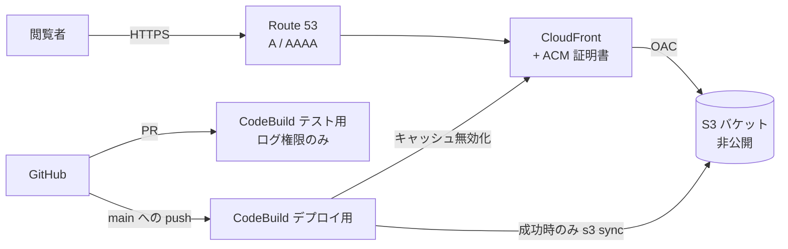

# infra（AWS 構成）

ポートフォリオサイトを AWS 上で配信し、CodeBuild で CI/CD を行うための CloudFormation テンプレートです。テンプレート1つ（[template.yaml](template.yaml)）で、配信基盤と CI をまとめて作成します。

## 構成



| ファイル | 内容 |
|---|---|
| [template.yaml](template.yaml) | CloudFormation テンプレート（このディレクトリ） |
| [../buildspec.test.yml](../buildspec.test.yml) | テスト用のビルド手順。プルリクエストで実行（`CodeBuildTestProject` から参照） |
| [../buildspec.yml](../buildspec.yml) | デプロイ用のビルド手順。`DeployBranch` への push で実行（`CodeBuildProject` から参照） |
| [../tests/infra-template.test.ts](../tests/infra-template.test.ts) | テンプレートの設定値を検証するテスト（`npm test` で実行） |

## 作成されるリソース

| 論理 ID | 種類 | 内容 |
|---|---|---|
| `SiteBucket` | S3 バケット | サイトのファイル置き場。パブリックアクセスをすべてブロック、SSE-S3 暗号化、バージョニング有効（旧バージョンは30日で削除）。スタックを削除しても残る（`DeletionPolicy: Retain`） |
| `SiteBucketPolicy` | バケットポリシー | このディストリビューションからの `s3:GetObject` だけを許可。HTTPS 以外のアクセスは拒否 |
| `OriginAccessControl` | CloudFront OAC | CloudFront が署名付きで S3 を読むための設定 |
| `Certificate` | ACM 証明書 | `DomainName` の証明書。DNS 検証で、検証用レコードはホストゾーンに自動作成される |
| `DirectoryIndexFunction` | CloudFront Function | `/about/` や `/about` へのリクエストを `/about/index.html` に置き換える（Astro の出力形式に合わせる） |
| `Distribution` | CloudFront | HTTPS へリダイレクト、TLS 1.2 以上、HTTP/2・HTTP/3、IPv6。キャッシュはマネージドの CachingOptimized、レスポンスヘッダーは SecurityHeadersPolicy。403/404 は `/404.html` を 404 で返す |
| `AliasRecordA` / `AliasRecordAAAA` | Route 53 | `DomainName` から CloudFront へのエイリアス |
| `BuildLogGroup` / `TestLogGroup` | CloudWatch Logs | CodeBuild のログ（デプロイ用・テスト用で分ける。30日保存） |
| `CodeBuildTestRole` | IAM ロール | テスト用。`TestLogGroup` への書き込みだけを許可（S3・CloudFront には触れない）。このアカウントの `<スタック名>-test` からだけ引き受けられる |
| `CodeBuildTestProject` | CodeBuild | `<スタック名>-test`。`GitHubActorAccountId` のアカウントが出したプルリクエストだけで、テスト・lint・ビルドを実行する（同時実行は1件） |
| `CodeBuildRole` | IAM ロール | デプロイ用。`BuildLogGroup` への書き込み、`SiteBucket` の一覧・読み書き・削除、このディストリビューションの無効化だけを許可。このアカウントの `<スタック名>-deploy` からだけ引き受けられる |
| `CodeBuildProject` | CodeBuild | `<スタック名>-deploy`。`DeployBranch` への push でビルドし、成功したらデプロイする（同時実行は1件） |
| `WebAcl` | AWS WAF | `EnableWaf=true` のときだけ作る。IP ごとに 5 分間 1000 リクエストを超えたら遮断する |
| `CostBudget` | AWS Budgets | 月額料金が予算の 80% を超えた（実績）・100% を超えそう（予測）なときに `BudgetAlertEmail` へメールする |

## 前提

1. **AWS CLI**（v2）と、スタックを作成できる権限（IAM ロールを作るため `CAPABILITY_IAM` が必要）。
2. **Route 53 のホストゾーン**: サイトのドメインを管理するホストゾーンが作成済みであること。ドメインをほかのレジストラで取得した場合は、ネームサーバーをこのホストゾーンに向けておく。
3. **CodeBuild への GitHub 認証情報の登録**: Webhook の作成に必要。**us-east-1 で**登録する（認証情報はリージョンごと）。
   - コンソール: CodeBuild →（任意のプロジェクト作成画面の）ソースで「GitHub に接続」
   - CLI（個人用アクセストークンの場合）:
     ```bash
     aws codebuild import-source-credentials --region us-east-1 \
       --server-type GITHUB --auth-type PERSONAL_ACCESS_TOKEN --token <トークン>
     ```
   - トークンはリポジトリやテンプレートに置かないこと。

## パラメーター

| 名前 | 必須 | 既定値 | 内容 |
|---|---|---|---|
| `DomainName` | ○ | — | サイトのドメイン名（例 `portfolio.example.com`）。`HostedZoneId` のゾーン内の名前にする |
| `HostedZoneId` | ○ | — | `DomainName` を管理している Route 53 ホストゾーンの ID |
| `GitHubRepoUrl` | ○ | — | GitHub リポジトリの HTTPS URL（例 `https://github.com/<owner>/<repo>.git`） |
| `DeployBranch` | | `main` | push されたときに本番へデプロイするブランチ |
| `GitHubActorAccountId` | ○ | — | プルリクエストのビルドを許可する GitHub アカウントの数値 ID（`gh api users/<ユーザー名> -q .id` で確認）。公開リポジトリのため、ほかのアカウントの PR ではビルドしない |
| `BudgetAlertEmail` | ○ | — | 料金アラートの送り先メールアドレス |
| `MonthlyBudgetUsd` | | `10` | 月額料金の予算（USD） |
| `EnableWaf` | | `false` | `true` で CloudFront に WAF（レート制限）を付ける。Web ACL とルールの月額固定費（数 USD）がかかる |

## セキュリティ上の前提（テンプレートの外で設定するもの）

- **GitHub の認証情報は、このリポジトリだけに絞る**: CodeBuild に登録した認証情報は、そのアカウント・リージョンのすべての CodeBuild プロジェクトで共有される。AWS CodeConnections（GitHub App）を使うか、個人用アクセストークンならこのリポジトリだけを対象にした fine-grained トークンにする（classic トークンの `repo` は全リポジトリへの書き込み権限になる）。
- **`main` にブランチ保護を付ける**: `DeployBranch` への push はそのまま本番に出る。GitHub の Settings → Branches で、PR 必須・テスト用 CodeBuild の成功必須・force push 禁止にする。
- **アカウントの監視を有効にする**: CloudTrail（管理イベント）と GuardDuty を有効にしておく（このテンプレートでは作らない）。料金は `CostBudget` のメールで気づけるようにしている。
- **ビルドで依存のインストールスクリプトを実行しない**: buildspec と `npm run build:apps` は `npm ci --ignore-scripts` で依存を入れる。インストール時のスクリプトが必要な依存を追加するときは、デプロイ用の権限で動くことを踏まえて buildspec に明示的に追加する。

## スタックの作成

CloudFront で使う ACM 証明書は us-east-1 でしか作れないため、**必ず us-east-1 に**作成します。ほかのリージョンを指定すると、テンプレートの `Rules` によって作成前に失敗します。

コマンドはすべて `portfolio-site/` で実行します。

```bash
# 1. テンプレートの構文チェック
aws cloudformation validate-template --region us-east-1 --template-body file://infra/template.yaml

# 2. 作成（2回目以降は同じコマンドで更新になる）
aws cloudformation deploy \
  --region us-east-1 \
  --stack-name portfolio-site \
  --template-file infra/template.yaml \
  --capabilities CAPABILITY_IAM \
  --parameter-overrides \
    DomainName=portfolio.example.com \
    HostedZoneId=Z0123456789ABCDEFGHIJ \
    GitHubRepoUrl=https://github.com/<owner>/<repo>.git \
    DeployBranch=main \
    GitHubActorAccountId=<GitHub の数値 ID> \
    BudgetAlertEmail=<メールアドレス>

# 3. 出力（サイト URL・バケット名・ディストリビューション ID）を確認
aws cloudformation describe-stacks --region us-east-1 --stack-name portfolio-site \
  --query "Stacks[0].Outputs" --output table
```

証明書の DNS 検証と CloudFront の配置に時間がかかるため、初回の作成は数分〜数十分かかります。

| 出力 | 内容 |
|---|---|
| `SiteUrl` | サイトの URL（`https://<DomainName>/`） |
| `BucketName` | サイトのファイルを置く S3 バケット名 |
| `DistributionId` | CloudFront ディストリビューション ID |
| `AppsBaseUrl` | ポートフォリオのフロントエンドの配信先（`https://<DomainName>/apps/`）。各アプリは `<AppsBaseUrl><スラッグ>/`（[../docs/apps.md](../docs/apps.md)） |

## 初回デプロイ

スタックを作っただけではバケットは空です。`portfolio-site/` 配下を変更するコミットを `DeployBranch` に push すると、CodeBuild がビルドしてデプロイします。

すぐに反映したい場合は、ローカルでビルドして直接同期することもできます。

```bash
npm run build
aws s3 sync dist "s3://<BucketName>" --delete
aws cloudfront create-invalidation --distribution-id <DistributionId> --paths "/*"
```

## CI / デプロイ

テスト用とデプロイ用で、CodeBuild のプロジェクトと buildspec を分けています。プルリクエストのビルド（フォークからの PR を含む）は、デプロイ先への権限を持たないプロジェクトで実行されます。

Webhook が反応するのは、`portfolio-site/` 配下のファイルを変更した次のイベントだけです。

| イベント | プロジェクト | buildspec | 動作 |
|---|---|---|---|
| プルリクエストの作成・更新・再オープン | `<スタック名>-test` | [../buildspec.test.yml](../buildspec.test.yml) | テスト・lint・ビルドのみ。結果は GitHub の PR に表示される |
| `DeployBranch` への push | `<スタック名>-deploy` | [../buildspec.yml](../buildspec.yml) | テスト・lint・ビルド、成功したらデプロイ |

どちらの buildspec も、次の手順は共通です（同じであることをテストで確認しています）。

1. `install`: Node.js 22 で `npm ci`
2. `build`: `npm test` → `npm run lint` → `npm run test:build`（ビルドと、成果物に管理画面が含まれないことなどの検証）

デプロイ用の [../buildspec.yml](../buildspec.yml) だけが、続けて `post_build` を実行します。次の**すべて**を満たすときだけ、`dist/` を S3 に同期（`--delete`）し、CloudFront のキャッシュを無効化します。

- ビルドが成功している（`CODEBUILD_BUILD_SUCCEEDING = 1`）
- Webhook のイベントが `PUSH`
- push 先が `refs/heads/<DeployBranch>`

そのため、デプロイ用プロジェクトを CodeBuild のコンソールから手動で開始しても、Webhook のイベントがないのでデプロイされません。手動でテストだけを実行したいときは、テスト用プロジェクトでビルドを開始し、ソースのバージョンにブランチ名やコミットを指定します。

デプロイ用プロジェクトに渡す環境変数（テンプレートで設定。テスト用プロジェクトには渡さない）:

| 変数 | 値 |
|---|---|
| `SITE_BUCKET` | `SiteBucket` のバケット名 |
| `DISTRIBUTION_ID` | `Distribution` の ID |
| `DEPLOY_BRANCH` | パラメーター `DeployBranch` |

## スタックの削除

```bash
aws cloudformation delete-stack --region us-east-1 --stack-name portfolio-site
```

S3 バケットは誤削除を防ぐため、スタックを消しても残ります（`DeletionPolicy: Retain`）。不要なら、バージョニングが有効なので**旧バージョンも含めて**空にしてから削除してください（コンソールの「空にする」が簡単です）。

## テンプレートを変更するとき

- `npm test` に含まれる [../tests/infra-template.test.ts](../tests/infra-template.test.ts) が、要件に関わる設定（非公開バケット、OAC、HTTPS 限定、us-east-1 の制約、Webhook の条件、IAM にワイルドカードの Action がないこと など）を検証します。設定を変えたらテストも合わせて更新してください。
- 反映前に `aws cloudformation deploy` に `--no-execute-changeset` を付けると、変更セットだけを作って内容を確認できます。

## うまくいかないとき

| 症状 | 確認すること |
|---|---|
| 証明書が「検証保留中」のまま進まない | `HostedZoneId` が `DomainName` を管理するゾーンか。ドメインのネームサーバーがそのゾーンを向いているか |
| `CodeBuildProject` の作成で Webhook のエラーになる | us-east-1 に GitHub の認証情報を登録したか。トークンにリポジトリと Webhook の権限があるか |
| PR や push でビルドが始まらない | 変更が `portfolio-site/` 配下を含むか。push 先が `DeployBranch` か。PR は `-test`、push は `-deploy` のプロジェクトの履歴を見ているか |
| ビルドは成功するのにデプロイされない | 手動開始のビルドではないか（Webhook の PUSH のみデプロイ） |
| ページが 404 になる | `npm run build` の成果物が同期されているか。URL の綴り（パスは末尾 `/` 付き） |
