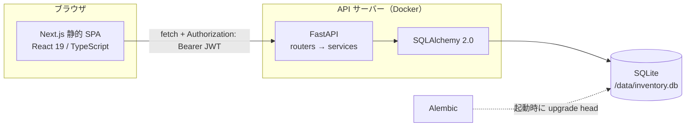
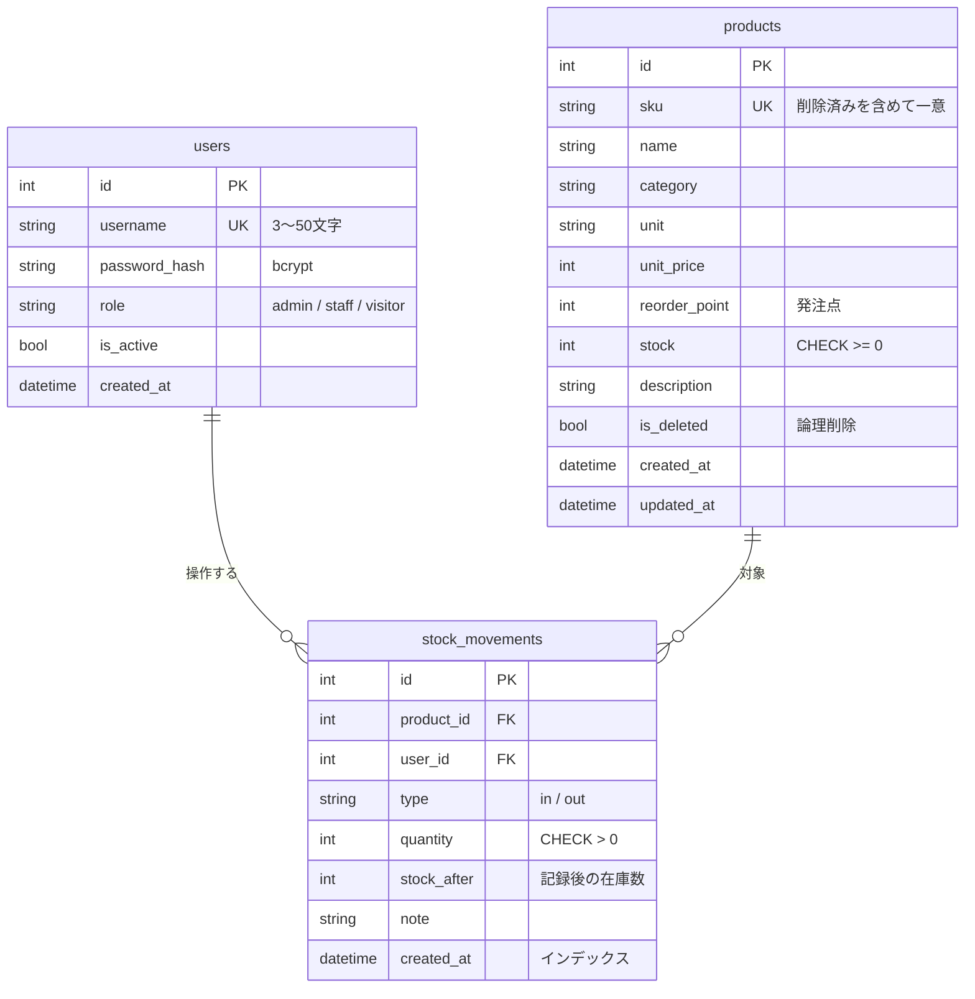
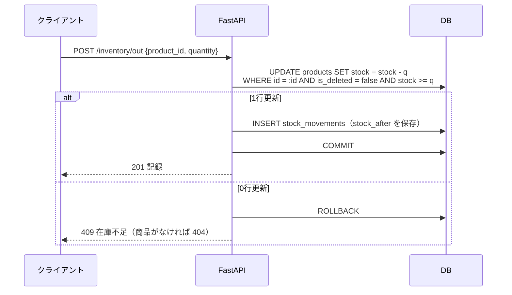
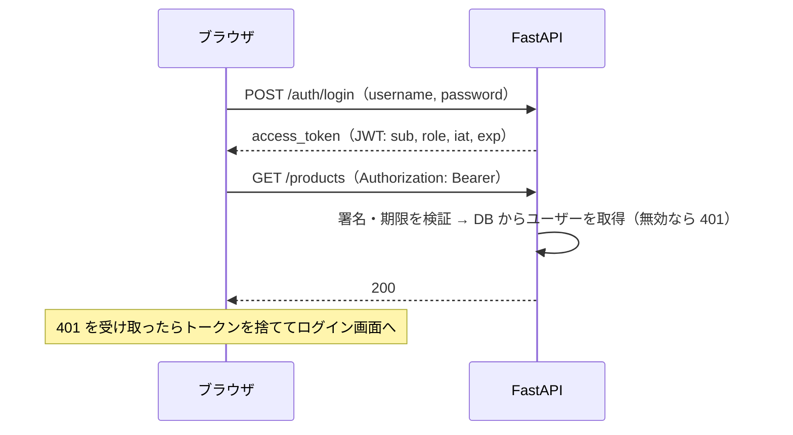

# 在庫管理システムの構成

要件・設計の詳細は [specs/requirements.md](specs/requirements.md)・[specs/design.md](specs/design.md) を参照。ここでは全体像を図でまとめる。

## システム構成

- フロントエンドは `next build` の静的出力。S3 などのサブパス配下で配信でき、API の URL はビルド時の環境変数で切り替える。
- バックエンドは `routers/`（入出力・HTTP のエラー）と `services/`（在庫の増減などの業務ロジック）に分け、業務ロジックを HTTP から独立してテストできるようにしている。

## ER 図

## 在庫の増減（整合性の担保）

判定と減算が1文の UPDATE にまとまっているため、同時に出庫が来ても DB が1件ずつ適用し、在庫が足りない方は0行更新になる。`tests/test_inventory_concurrency.py` で8スレッドの同時出庫を行い、在庫がマイナスにならないことを確認している。

## 認証・認可

| 操作 | 管理者 | 一般 |
|---|---|---|
| 商品の登録・更新、入出庫の記録、各種参照 | ○ | ○ |
| 商品の削除 | ○ | × (403) |
| ユーザーの登録・一覧 | ○ | × (403) |

## 画面一覧

| パス | 画面 |
|---|---|
| `/login` | ログイン |
| `/` | ダッシュボード（集計・棒グラフ・在庫が少ない商品・直近の入出庫） |
| `/products` | 商品一覧（検索・編集・削除） |
| `/products/new` | 商品登録 |
| `/products/edit?id=` | 商品編集（静的出力のため ID はクエリで指定） |
| `/inventory` | 在庫一覧（並び替え・在庫が少ない表示） |
| `/inventory/record` | 入出庫の登録 |
| `/inventory/history` | 入出庫履歴（絞り込み・ページ送り） |
| `/users` | ユーザー管理（管理者のみ） |

## テスト

| 対象 | 内容 |
|---|---|
| `backend/tests/` | API の正常系・異常系（401・403・404・409・422）、マイグレーション、並行出庫、集計と入出庫の合計の一致、CLI、OpenAPI の網羅 |
| `frontend/src/**/*.test.ts(x)` | API クライアント、認証コンテキスト、商品フォーム、棒グラフ、整形・並び替え・集計の関数 |
