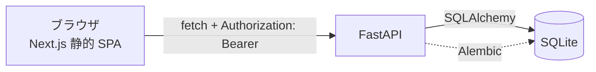

# 在庫管理システム 設計（design.md）

## TL;DR

FastAPI（SQLAlchemy 2.0 + Alembic + SQLite）の REST API と、静的出力した Next.js（App Router + TypeScript）の SPA で在庫管理システムを作る。認証は Bearer の JWT アクセストークン、権限は admin／staff の2区分。在庫数は商品テーブルに持ち、**条件付き UPDATE（`stock = stock - q WHERE stock >= q`）と入出庫記録の INSERT を1トランザクションで行う**ことで、並行出庫でも在庫がマイナスにならないことを DB レベルで保証する。

## 対応する要件

requirements.md の全要件（REQ-AUTH・USR・PRD・INV・HIS・SUM・DSH、NFR-*）。各節の見出しに対応 ID を書く。Non-Goals は requirements.md を引き継ぐ。技術的な Non-Goals として、PostgreSQL での本番運用・水平スケール・SSR（サーバーでの描画）は扱わない。

## 全体構成

```
portfolios/inventory-management/
├── package.json            # npm test / lint / build（backend と frontend をまとめて実行）
├── scripts/run-backend.mjs # backend の venv の python で pytest・ruff・alembic を実行する
├── docker-compose.yml      # 開発用（backend のみ。frontend は npm run dev）
├── .env.example
├── backend/
│   ├── pyproject.toml      # 依存・ruff・pytest の設定
│   ├── Dockerfile
│   ├── alembic.ini, alembic/versions/0001_initial.py
│   ├── app/
│   │   ├── main.py         # create_app()・CORS・ルーター登録・/health
│   │   ├── config.py       # Settings（pydantic-settings）
│   │   ├── db.py           # engine・SessionLocal・get_db
│   │   ├── models.py       # User・Product・StockMovement
│   │   ├── schemas.py      # Pydantic の入出力スキーマ
│   │   ├── security.py     # パスワードのハッシュ・JWT
│   │   ├── deps.py         # get_current_user・require_admin
│   │   ├── cli.py          # create-admin・seed-demo
│   │   ├── routers/        # auth.py・users.py・products.py・inventory.py
│   │   └── services/       # inventory.py（在庫の増減・履歴・集計）
│   └── tests/
├── frontend/
│   ├── next.config.ts      # output: "export"、basePath は環境変数
│   ├── src/lib/            # api.ts（fetch のラッパー）・auth.tsx（認証コンテキスト）・types.ts
│   ├── src/components/     # AppShell・BarChart・ProductForm など
│   └── src/app/            # 各画面
└── docs/                   # specs/・architecture.md
```



## データモデル（REQ-PRD・INV・USR）

```mermaid
erDiagram
  users ||--o{ stock_movements : "操作する"
  products ||--o{ stock_movements : "対象"
  users { int id PK; string username UK; string password_hash; string role; bool is_active; datetime created_at }
  products { int id PK; string sku UK; string name; string category; string unit; int unit_price; int reorder_point; int stock; string description; bool is_deleted; datetime created_at; datetime updated_at }
  stock_movements { int id PK; int product_id FK; int user_id FK; string type; int quantity; int stock_after; string note; datetime created_at }
```

| テーブル・列 | 制約・備考 |
|---|---|
| users.username | 一意、3〜50文字 `^[A-Za-z0-9_-]+$` |
| users.role | `admin` / `staff`（CHECK） |
| products.sku | 一意（削除済みを含む）、1〜50文字 |
| products.name | 1〜200文字 |
| products.category | 任意、〜100文字 |
| products.unit | 既定 `個`、1〜20文字 |
| products.unit_price | 任意、0以上の整数（円） |
| products.reorder_point | 既定0、0以上 |
| products.stock | 既定0、CHECK `stock >= 0`。入出庫でのみ更新 |
| products.is_deleted | 論理削除フラグ |
| stock_movements.type | `in` / `out`（CHECK） |
| stock_movements.quantity | CHECK `quantity > 0` |
| stock_movements.stock_after | 記録後の在庫数（履歴での追跡用） |
| stock_movements.created_at | インデックス（履歴の新しい順・期間絞り込み） |

日時はすべて UTC で保存し、API は ISO 8601（タイムゾーン付き）で返す。画面ではブラウザのローカル時刻で表示する。

## API 設計

共通: JSON。エラーは FastAPI 標準の `{"detail": ...}`。認証は `Authorization: Bearer <token>`。

| メソッド・パス | 権限 | 要件 | 成功 | 主なエラー |
|---|---|---|---|---|
| GET /health | なし | — | 200 `{"status":"ok"}` | — |
| POST /auth/login | なし | AUTH-1〜3 | 200 `{access_token, token_type:"bearer", expires_in}` | 401 |
| POST /auth/register | admin | USR-1〜4 | 201 UserOut | 401・403・409・422 |
| GET /users/me | ログイン | AUTH-4 | 200 UserOut | 401 |
| GET /users | admin | USR-5 | 200 UserOut[] | 401・403 |
| GET /products?q=&include_deleted= | ログイン | PRD-4・5・HIS-5 | 200 ProductOut[] | 401 |
| POST /products | ログイン | PRD-1〜3 | 201 ProductOut | 409・422 |
| GET /products/{id} | ログイン | PRD-6・10 | 200 ProductOut | 404 |
| PUT /products/{id} | ログイン | PRD-7・2・3・10 | 200 ProductOut | 404・409・422 |
| DELETE /products/{id} | admin | PRD-8〜10 | 204 | 403・404 |
| POST /inventory/in | ログイン | INV-1・4・5・7 | 201 MovementOut | 404・422 |
| POST /inventory/out | ログイン | INV-2〜7 | 201 MovementOut | 404・409・422 |
| GET /inventory/history | ログイン | HIS-1〜4 | 200 `{items, total, limit, offset}` | 422 |
| GET /inventory/summary | ログイン | SUM-1〜4 | 200 `{items, total_products, total_stock, low_stock_count}` | 401 |

- **ログイン**は `application/x-www-form-urlencoded`（`OAuth2PasswordRequestForm`）で受け取る。Swagger UI の「Authorize」でそのまま試せるようにするため。
- **UserOut**: `id, username, role, is_active, created_at`。**ProductOut**: 全列（`is_deleted` を含む。一覧は既定で削除済みを除き、`include_deleted=true` で含める）。**MovementOut**: `id, product_id, product_sku, product_name, type, quantity, stock_after, note, user_id, username, created_at`。
- **MovementCreate**: `product_id: int`、`quantity: int (1〜1,000,000)`、`note: str | None (〜500文字)`。Pydantic の `strict` な int にし、`1.5` や `"3"` を 422 にする。
- **history のクエリ**: `product_id`、`type`（in/out）、`date_from`・`date_to`（`YYYY-MM-DD`、両端を含む）、`utc_offset_minutes`（-840〜840、既定0。日付を利用者のタイムゾーンの0時〜24時として解釈する。画面はブラウザのタイムゾーンを渡す）、`limit`（1〜100、既定20）、`offset`（0以上、既定0）。並びは `created_at DESC, id DESC`。
- **summary の items**: `product_id, sku, name, unit, stock, reorder_point, is_low`（`stock <= reorder_point`）。商品コード順。
- `PUT /products/{id}` は全項目の置き換え（`stock` は受け取らない。送られても無視する）。

## 在庫の増減と整合性（REQ-INV・SUM-2）

`services/inventory.py`:

```
record_movement(db, *, user, product_id, type, quantity, note) -> StockMovement
  1. 対象の商品が存在し未削除であることを確認（なければ NotFound → 404）
  2. in : UPDATE products SET stock = stock + :q, updated_at = now WHERE id = :id AND is_deleted = false
     out: UPDATE products SET stock = stock - :q, updated_at = now WHERE id = :id AND is_deleted = false AND stock >= :q
  3. 更新行数が0 → out なら InsufficientStock（409）、in なら NotFound
  4. 更新後の stock を読み、stock_movements に INSERT（stock_after に保存）
  5. commit（失敗時は rollback。2〜4 が1トランザクション）
```

- 「読んでから書く」をせず、判定を UPDATE の WHERE 句に入れるため、同時に出庫が来ても DB が1つずつ適用し、条件を満たさない方は0行更新になる（SQLite は書き込みを直列化、PostgreSQL でも行ロックで同じ結果）。
- DB の CHECK `stock >= 0` を最後の防御線として置く。
- SQLite は `busy_timeout`（5秒）を設定し、同時書き込み時に即エラーにしない。

## 認証・認可（REQ-AUTH・USR、NFR-SEC）

- パスワード: `bcrypt`（コストは既定の12）。ユーザーが存在しないときもダミーのハッシュで照合し、応答時間でユーザーの有無がわからないようにする。
- JWT: PyJWT、HS256、クレームは `sub`（ユーザー ID の文字列）・`role`・`iat`・`exp`。有効期限は `ACCESS_TOKEN_EXPIRE_MINUTES`（既定60）。
- `get_current_user`: トークンを検証し、DB からユーザーを引く。ユーザーが存在しない・無効化されていれば 401（権限は DB の値を正とし、トークンの `role` は表示用）。
- `require_admin`: `role != "admin"` なら 403。
- フロントエンド: トークンを `localStorage` に保存する（使えない環境ではタブのメモリーに保持）。起動時のユーザー取得が 401 ならトークンを捨て、通信エラー・5xx ならトークンを残してエラーを表示する。React の自動エスケープに任せ、`dangerouslySetInnerHTML` を使わないことで XSS の面を小さくする。API が 401 を返したらトークンを捨ててログイン画面へ移る。

## 設定（NFR-ENV・SEC）

`app/config.py`（pydantic-settings、`.env` も読む）:

| 環境変数 | 既定 | 備考 |
|---|---|---|
| APP_ENV | `development` | `development`・`test` 以外（表記揺れを含む）は本番とみなして厳格チェック |
| DATABASE_URL | `sqlite:///./inventory.db` | |
| JWT_SECRET | 開発用の固定値 | production で未設定・32文字未満なら起動時に例外 |
| ACCESS_TOKEN_EXPIRE_MINUTES | 60 | |
| CORS_ORIGINS | `http://localhost:3000` | カンマ区切り |

フロントエンド: `NEXT_PUBLIC_API_BASE_URL`（既定 `http://localhost:8000`）、`NEXT_PUBLIC_BASE_PATH`（既定は空。配信時に `/apps/inventory-management`）。

## 画面設計（REQ-DSH・PRD・INV・HIS・SUM・USR）

静的出力のため動的ルート（`[id]`）は使わず、編集画面は `?id=` のクエリで商品を指定する。

| パス | 画面 | 権限 |
|---|---|---|
| /login | ログイン | なし |
| / | ダッシュボード | ログイン |
| /products | 商品一覧（検索・新規・編集・削除ボタン（管理者のみ表示）） | ログイン |
| /products/new | 商品登録 | ログイン |
| /products/edit?id= | 商品編集 | ログイン |
| /inventory | 在庫一覧（在庫数で並び替え・「少ない」表示） | ログイン |
| /inventory/record | 入出庫の登録（区分の切り替え） | ログイン |
| /inventory/history | 入出庫履歴（商品・区分・期間で絞り込み、ページ送り） | ログイン |
| /users | ユーザー一覧・登録 | 管理者（ナビゲーションにも管理者のみ表示） |

ワイヤーフレーム（ダッシュボード）:

```
┌─ 在庫管理 ─ [ダッシュボード][商品][在庫][入出庫][履歴][ユーザー]  alice(管理者) [ログアウト]
│ ┌商品数┐ ┌総在庫数┐ ┌在庫が少ない┐
│ │  12  │ │  1,340 │ │     3      │
│ └──────┘ └────────┘ └────────────┘
│ 在庫数 上位10商品          │ 在庫が少ない商品
│ A-001 ██████████ 320      │ B-002 ボールペン 2 / 発注点 10
│ A-002 ██████ 180          │ ...
│ 直近の入出庫: 日時 / 区分 / 商品 / 数量 / 担当
```

- 棒グラフは依存を増やさないよう、CSS の幅で描く自作コンポーネント（`BarChart`）にする。
- 幅375pxでは、カードは縦積み、表は横スクロールの枠に入れる（ページ全体は横スクロールさせない）。

## 検討した代替案

- **在庫数を履歴の合計から毎回算出する**: 二重管理がなく整合性は自明だが、出庫可否の判定に集計とロックが必要で、SQLite ではロック手段が乏しい。条件付き UPDATE の方が単純で、集計の一致はテストで保証する。→ 不採用。
- **SELECT ... FOR UPDATE で行ロック**: SQLite が対応しない。→ 不採用。
- **PostgreSQL**: 本番らしさは増すが、VPS 側（`portfolios/backend-compose/`）が SQLite の永続化に対応済みで、開発環境も軽くなる。SQLAlchemy 経由のため `DATABASE_URL` を変えれば移行できる。→ SQLite を採用。
- **httpOnly Cookie にトークンを保存**: XSS に強いが、S3（フロント）と VPS（API）が別オリジンになる配信形態では SameSite・CSRF 対策が必要になり、MVP の工数に合わない。→ localStorage を採用し、XSS 対策を設計で補う。
- **Next.js の SSR／Route Handlers**: portfolio-site は S3 の静的配信のため使えない。→ 静的出力の SPA。
- **axios**: fetch の薄いラッパーで足りる。依存を増やさない。→ fetch を採用。
- **グラフライブラリ（Recharts など）**: 横棒グラフ1つのために依存を増やさない。→ 自作。
- **公開のユーザー自己登録**: 業務システムでは管理者が発行するのが一般的。→ 管理者のみ。

## 横断的関心事

- **セキュリティ・プライバシー**: 上記「認証・認可」「設定」のとおり。個人情報はユーザー名のみ。SQL は ORM・バインド変数のみ。CORS は許可オリジンを限定。Swagger（`/docs`）は API 仕様の提示が目的のため本番でも公開する（認証が必要な API は Swagger からもトークンが要る）。
- **パフォーマンス**: 想定は数ユーザー・商品数百・記録数万件。履歴は `created_at` のインデックスとページングで対応。商品一覧はページングなし（数百件まで）。
- **オブザーバビリティ**: uvicorn のアクセスログに加え、在庫不足（409）を WARNING でログに出す。MVP としてメトリクスは持たない。
- **テスト戦略**: バックエンドは pytest + FastAPI の TestClient で API 単位の結合テスト（テストごとに一時ファイルの SQLite を作る）。在庫の並行出庫はスレッドで同時に出庫を行うテスト。フロントエンドは Vitest + Testing Library で API クライアント・認証コンテキスト・フォーム・グラフの単体テスト。ビルド（`next build`）で型と静的出力を確認する。
- **ロールアウト計画**: 新規プロジェクトのため既存への影響なし。初回は `alembic upgrade head` → `python -m app.cli create-admin`。スキーマ変更は Alembic のリビジョンで行い、ロールバックは `alembic downgrade -1`。本番への登録は別作業（Non-Goals）。

## 既存アーキテクチャとの整合性

- バックエンドの Dockerfile は非 root ユーザーで動かし、DB を `/data` に置けるよう `DATABASE_URL` で指定可能にする（`portfolios/backend-compose/` の永続化の方式に合わせる）。
- フロントエンドの静的出力・サブパス配信は portfolio-site の `/apps/<スラッグ>/` 配信の方式に合わせる。
- 逸脱: 設計ファイル・作業ログをリポジトリ標準の `docs/specs/`・`logs/` ではなくプロジェクト内に置く（依頼の「`portfolios/` 以下以外は修正しない」を優先したため）。

## 実装者に任せること

- 画面の配色・細かなレイアウト（上記ワイヤーフレームと NFR-UI-1 を満たす範囲）
- エラーメッセージの文言（日本語で、原因がわかるもの）
- テストのフィクスチャの構成
