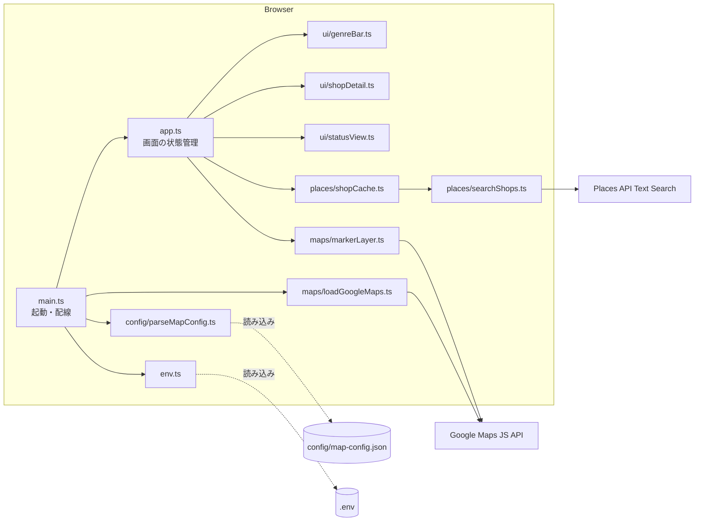
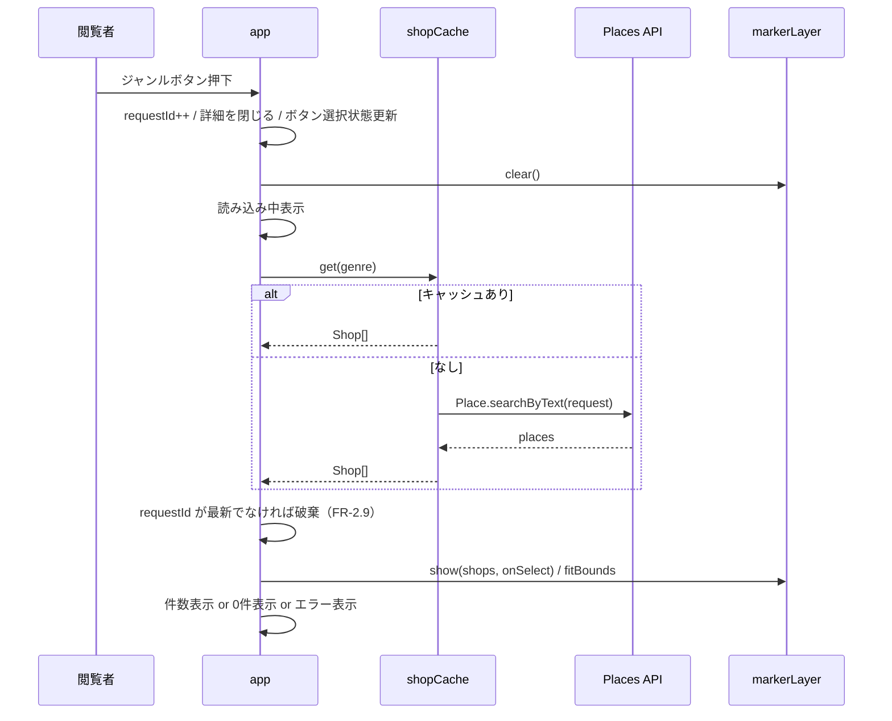

# 設計: 新宿グルメマップ（shinjuku-gourmet-map）

要件: [requirements.md](requirements.md) ／ タスク: [tasks.md](tasks.md)

## TL;DR

Vite + TypeScript（フレームワークなし）の静的Webアプリとして作り、ブラウザから Google Maps JavaScript API（地図・Advanced Marker）と Places API（New）の Text Search を直接呼ぶ。ジャンルとエリアは `src/config/map-config.json` に書き、APIキーは `.env` の `VITE_GOOGLE_MAPS_API_KEY` から読む。サーバーを持たず、検索結果をジャンルごとにメモリへキャッシュして無料利用枠内に収める。

## Non-Goals（技術面）

- サーバーサイド（APIプロキシ・DB）を持たない。APIキーの秘匿はサーバーではなく Google Cloud 側のキー制限で担保する。
- UIフレームワーク（React等）を使わない。画面要素が「ボタン列・地図・詳細パネル」の3つだけで、状態も「選択中ジャンル・選択中店舗」程度のため。
- `@types/google.maps` を使わず、利用する範囲だけの最小の型を自前で定義する（依存を増やさないため）。
- オフライン対応・PWA化・多言語化はしない。

## 全体構成



ディレクトリ構成（`portfolios/shinjuku-gourmet-map/` 配下）:

```
index.html
env.template            # .env の雛形（値は空）
src/
  main.ts               # 起動処理（設定・キー読み込み→地図読み込み→app起動）
  app.ts                # ジャンル選択・検索・ピン・詳細の状態遷移
  env.ts                # 環境変数からAPI設定を取り出す
  styles.css
  config/
    map-config.json     # ★作者が編集するファイル（ジャンル・エリア）
    parseMapConfig.ts   # 設定の検証と型付け
  maps/
    googleTypes.ts      # 利用するGoogle Maps APIの最小型
    loadGoogleMaps.ts   # Maps JS API の読み込み
    markerLayer.ts      # ピンの表示・削除・強調・表示範囲調整
  places/
    shop.ts             # 店舗データ型
    searchShops.ts      # Text Search 呼び出しと店舗データへの変換
    shopCache.ts        # ジャンル単位のキャッシュ
  ui/
    genreBar.ts         # ジャンルボタン列
    shopDetail.ts       # 店舗詳細パネル
    statusView.ts       # 読み込み中・件数・エラー表示
docs/specs/             # 本ドキュメント群
```

## データモデル

### 設定ファイル `src/config/map-config.json`（FR-4.1）

```json
{
  "area": {
    "name": "新宿",
    "center": { "lat": 35.6896, "lng": 139.7006 },
    "radiusMeters": 1500,
    "zoom": 15
  },
  "genres": [
    { "id": "ramen", "label": "ラーメン", "query": "新宿 ラーメン" }
  ]
}
```

| 項目 | 制約（parseMapConfig で検証、FR-4.2） |
| --- | --- |
| `area.name` | 空でない文字列 |
| `area.center.lat` / `lng` | 数値。lat は -85〜85（極付近は検索範囲を計算できないため）、lng は -180〜180 |
| `area.radiusMeters` | 1〜50000 の数値 |
| `area.zoom` | 1〜21 の数値 |
| `genres` | 1件以上の配列 |
| `genres[].id` | 英小文字・数字・ハイフンの文字列。重複不可 |
| `genres[].label` / `query` | 空でない文字列 |
| `genres[].icon` | 任意。ボタンに添える絵文字など |

違反はすべて集めて `ConfigError`（`problems: string[]`、例: `genres[1].id: "ramen" が重複しています`）として投げ、画面に列挙する。

### 店舗 `Shop`（FR-3.2, FR-3.3）

```ts
interface Shop {
  id: string;
  name: string;
  address: string;
  location: { lat: number; lng: number };
  rating?: number;
  userRatingCount?: number;
  openingHours?: string[]; // 曜日ごとの営業時間（Google の weekdayDescriptions）
  phoneNumber?: string;
  websiteUrl?: string;
  googleMapsUrl: string;
}
```

Places API の `Place` から `toShop()` で変換する。`location` がない店舗は地図に置けないため除外する。`googleMapsURI` がない場合は `https://www.google.com/maps/search/?api=1&query=<店名>&query_place_id=<id>` を組み立てる。`websiteUrl`・`googleMapsUrl` は `http:`/`https:` 以外なら捨てる（NFR-3）。

## 主要な処理

### 起動（main.ts）

1. `parseMapConfig(json)` — 失敗時は `statusView` に問題一覧を出して終了（FR-4.2）。
2. ジャンルバーを描画（FR-1.1）。地図が使えない場合もジャンル構成は見えるようにする。
3. `readApiSettings(import.meta.env)` — キーが空なら案内文を表示して終了（FR-5.3）。
4. `loadGoogleMaps(settings)` で Maps JS API を読み込み（ページで1回だけ）、`core`・`maps`・`marker`・`places` ライブラリを取得。script の読み込み失敗・30秒のタイムアウト（`LOAD_TIMEOUT_MS`）・認証失敗（`window.gm_authFailure`）時はメッセージを表示し、ジャンルボタンを無効にする。最初に表示した原因は後続のエラーで上書きしない（FR-5.4）。
5. `new Map(el, { center, zoom, mapId })` を1回だけ生成し（FR-2.3）、`createApp(...)` に渡して先頭ジャンルを選択（FR-1.2）。

### ジャンル選択（app.ts の `selectGenre`）



- 詳細を閉じる・前のピンを消す（FR-2.2, FR-3.6）のは検索開始時点で行う。
- 失敗時はエラーを表示するだけで、ボタンは無効化しない（FR-2.8）。キャッシュは失敗した Promise を保持しないため、同じジャンルを押し直すと再検索する。

### 検索リクエスト（searchShops.ts、NFR-1）

```ts
Place.searchByText({
  textQuery: genre.query,
  fields: ["id","displayName","formattedAddress","location","rating","userRatingCount",
           "regularOpeningHours","nationalPhoneNumber","websiteURI","googleMapsURI"],
  locationRestriction: boundsAround(area.center, area.radiusMeters), // 矩形
  maxResultCount: 20,
  language: "ja",
  region: "jp",
});
```

`locationRestriction` は矩形しか受け付けないため、中心と半径から緯度経度の矩形を計算する（`boundsAround`、1度あたりの距離で近似）。

### ピン（markerLayer.ts、FR-2.1・2.4・3.7）

- `AdvancedMarkerElement` の `content` に自前の `<div class="pin">` を渡す。選択中は `pin--selected` クラスを付ける（色・サイズで区別）。
- `gmpClickable: true`、`title` に店名を設定し、キーボードでも選択できるようにする。
- 表示後、全ピンを含む `LatLngBounds` で `map.fitBounds()`。1件、または全店舗が約50m以内に集まっている場合は中心へ移動してズーム17（設定の初期ズームの方が大きければそちら）にする。0件ならエリアの初期表示に戻す。
- Advanced Marker には Map ID が必要なため、`.env` の `VITE_GOOGLE_MAPS_MAP_ID` を使い、未設定なら Google 公式のデモ用ID `DEMO_MAP_ID` を使う。

### 詳細パネル（shopDetail.ts、FR-3）

- PCでは地図の右側、幅768px未満では画面下部のシートとして表示する（CSS で切り替え）。
- DOM は `textContent` / `createElement` のみで組み立て、`innerHTML` を使わない（NFR-3）。
- 「Googleマップで開く」「Webサイト」は `target="_blank" rel="noopener noreferrer"`（FR-3.4）。
- 開いたら「閉じる」ボタンにフォーカスを移し、閉じたらピン選択を解除する（NFR-6）。

## 要件との対応

| 要件 | 設計要素 |
| --- | --- |
| FR-1.1, 1.4, 1.5, NFR-6 | `ui/genreBar.ts`（`aria-pressed`）／検索ボックスを置かない |
| FR-1.2, 1.3, 2.2, 2.3, 2.5〜2.9, 3.6 | `app.ts` の `selectGenre`、`ui/statusView.ts` |
| FR-2.1, 2.4, 3.7 | `maps/markerLayer.ts` |
| FR-3.1〜3.5, NFR-3 | `ui/shopDetail.ts`、`places/searchShops.ts` の `toShop` |
| FR-4.1, 4.2 | `config/map-config.json`、`config/parseMapConfig.ts` |
| FR-5.1〜5.4, NFR-2 | `env.ts`、`maps/loadGoogleMaps.ts`、`.gitignore`、`env.template`、README |
| NFR-1 | `places/shopCache.ts`、`maxResultCount: 20` |
| NFR-4 | 検索1回＋描画のみ・キャッシュ |
| NFR-5 | `styles.css` のレスポンシブ指定 |
| NFR-7 | 地図のロゴ・帰属表示を隠すCSSを書かない。詳細パネルに「情報提供: Google」を表示 |
| NFR-8 | `package.json` の scripts |

## 検討した代替案

- **React / Next.js**: 状態が少なく、フレームワークの学習・依存コストに見合わないため不採用。将来お気に入り等で画面が増えたら再検討する。
- **ビルドなしの単一HTML**: `.env` からキーを注入できず、テストも書きにくいため不採用。
- **サーバー（Cloud Functions等）経由で Places API を呼びキーを秘匿**: キーは守れるが、ランニングコスト0円とサーバー運用ゼロの要望に反するため不採用。Maps JS API の地図表示自体はどのみちブラウザにキーが必要。
- **店舗データを事前取得してJSONで同梱**: API呼び出し回数は最小になるが、Places API の規約上、店舗情報の長期保存（キャッシュ）は制限されており、情報も古くなるため不採用。
- **`@googlemaps/js-api-loader` パッケージ**: 読み込み処理は数十行で書け、依存を増やさない方針のため不採用。
- **InfoWindow で詳細表示**: スマホでは地図上の吹き出しが狭く営業時間などが読みにくいため、専用パネルを採用。
- **locationBias（円）**: エリア外の店舗も返るため、矩形の `locationRestriction` を採用。

## 横断的関心事

### セキュリティ・プライバシー

- APIキー: `.env`（Git管理外、`.gitignore` で除外）から Vite のビルド時に埋め込む。配信物には含まれるため、README で Google Cloud Console の「HTTPリファラー制限（公開URLとlocalhostのみ）」「API制限（Maps JavaScript API と Places API (New) のみ）」「1日あたりの上限」を設定させる（NFR-2）。リポジトリには値を空にした `env.template` だけを置く。
- 外部データのXSS対策: Google から返る文字列は `textContent` で表示し、URL はスキーム検証する（NFR-3）。
- 閲覧者の個人情報（位置情報など）は取得しない。

### パフォーマンス・スケーラビリティ／コスト

- 1ジャンル1リクエスト・最大20件。同一セッション内はメモリキャッシュで再リクエストしない（NFR-1）。
- 無料利用枠（SKUごとの月間無料回数）を超えないよう、README で1日あたりのクォータ上限設定を必須手順として案内する。ポートフォリオの想定アクセス（1日数十人程度）では枠内に収まる見込み。
- 地図生成は1回のみ（FR-2.3）。

### オブザーバビリティ

- サーバーを持たないため、ログ収集基盤は置かない。検索・読み込みの失敗は画面に表示し、詳細を `console.error` に出す。API使用量は Google Cloud Console の指標で確認する（README に記載）。

### テスト戦略

- Vitest + jsdom で単体テストを書く。Google Maps の実APIは呼ばず、`googleTypes.ts` の最小型に沿ったフェイクを注入する。
- 対象: 設定検証、環境変数読み込み、ローダー（script タグのURL・コールバック・失敗時）、検索リクエスト生成と `toShop` 変換、キャッシュ、ジャンルバー、詳細パネル、ピンレイヤー、app の状態遷移（初期選択・切替・競合・0件・エラー・詳細の開閉）。
- 実際の地図表示は手動確認（APIキーが必要なため自動テストの対象外）。

### ロールアウト計画

- 新規の独立プロジェクトで既存への影響はない。`npm run build` の `dist/` を GitHub Pages・Netlify・Vercel などの無料静的ホスティングに置く手順を README に書く。ロールバックは前のビルドを置き直すだけ。

## 既存アーキテクチャとの整合性

- リポジトリ規則どおり、プロジェクトは `portfolios/shinjuku-gourmet-map/` に閉じ、`package.json` もこの中に置く。
- 既存の `portfolios/inventory-management` に倣い、仕様書はプロジェクト内の `docs/specs/` に置く（`portfolios/` 以下以外を変更しないという今回の指示による。リポジトリ共通の `docs/specs/` は使わない）。
- 同じ理由で、作業ログもリポジトリルートの `logs/` ではなくプロジェクト内の `logs/` に置く（意図的な逸脱）。
